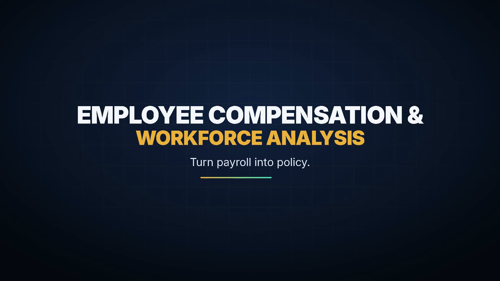

# Employee-Compensation-and-Workforce-Analysis-

  

End-to-end data analytics project using Python, SQL, MySQL, and Power BI to analyze workforce distribution, salary patterns, and payroll.

**Dataset → Python → Cleaning → Feature Engineering → EDA → MySQL → SQL Analysis → Power BI → Dashboard → Report**

# Which dataset do we use?

### Original dataset

`hr_workforce_dataset.csv`

This is the original 107-row × 20-column dataset.

We use this as the starting point.

### Cleaned dataset

`hr_workforce_clean.csv`

This is created by the Python code.

It contains 107 rows × 22 columns before the later notebook removes analysis-unnecessary columns in memory.

The added columns are:

- `hire_year`
- `salary_band`
- `has_commission`
- `pay_range_position`
- `pay_level`

The cleaned file is then used for MySQL and Power BI.

## What is the project actually about?

A company has employee information.

We are acting like a junior data analyst.

We use the data to understand:

- employee distribution
- salary distribution
- salary by department
- salary by region
- commission
- hiring history
- salary bands
- employee salary position inside job ranges
- managers and team sizes
- previous job history
- payroll by country

## Files

- Employee Compensation and Workforce Analysis using Python.ipynb
- hr_workforce dataset
- hr_workforce cleaned version dataset after data analysis using python
- Employee Compensation and Workforce Analysis using SQL
- Employee Compensation and Workforce Analysis PowerBI Dashboard.pbix
- Employee Compensation and Workforce Analysis Project Report
- Employee Compensation and Workforce Analysis PPT
